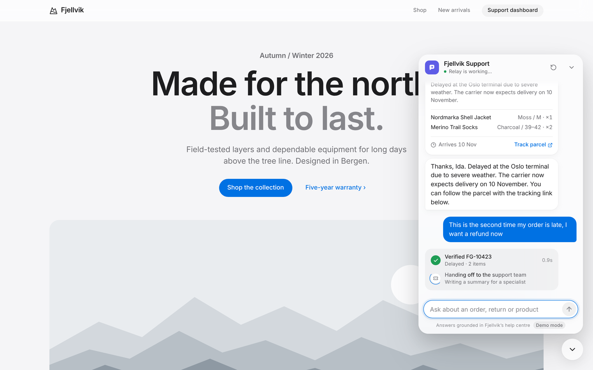

# Relay — AI Support Agent

Relay is a portfolio demo of a custom-coded AI customer support workflow for **Fjellvik Gear**, a fictional Norwegian outdoor retailer. It answers from an approved knowledge base, securely checks mock orders, and hands difficult cases to a human with a structured summary.

The project is intentionally focused on one polished support journey rather than production-scale infrastructure.



## Design

The interface follows a calm, Apple-inspired design system shared across my portfolio projects:

- **Chat as a sheet that grows from its launcher.** It opens and closes along the same path, using critically damped springs (`motion`), with press feedback on pointer-down.
- **Tool calls shown as live status rows.** Knowledge search, order verification and ticket creation each show a spinner that turns into a check, a short detail line and the elapsed time. Order and handoff results follow as cards.
- **Escalation is clearly visible.** Once a ticket exists, the chat header, a handoff card and a banner all show that a person has taken over.
- **Dashboard:** a translucent sticky header, stats with tabular numbers, status pills, staggered list entry, skeleton loading and simple empty states.
- **Light and dark mode** from shared design tokens. It works at 390px wide and respects reduced motion, reduced transparency and increased contrast.

More screenshots (light, dark, desktop, mobile) are in [`docs/screens`](docs/screens).

## What it demonstrates

- Streamed customer chat using the Vercel AI SDK and OpenAI
- Retrieval-augmented answers from 10 Fjellvik help articles
- Visible knowledge search, order lookup, and escalation tool activity
- Source cards attached to grounded policy answers
- Order verification using both order number and email
- Rule-guided human handoff with category, priority, sentiment, and summary
- A live support dashboard backed by local JSON data

## Architecture

```text
Customer chat
    │
    ▼
POST /api/chat ──► OpenAI chat model
    │                  │
    │                  ├── searchKnowledgeBase
    │                  │      └── query embedding + in-memory cosine search
    │                  ├── lookupOrder
    │                  │      └── verified local order data
    │                  └── createSupportTicket
    │                         └── local ticket repository
    ▼
AI SDK stream: text + tool states + source/order/ticket cards

Local conversations + tickets ──► GET /api/dashboard ──► polling dashboard
```

Important implementation points:

- [`lib/agent/system-prompt.ts`](lib/agent/system-prompt.ts) keeps Relay's tone, grounding, privacy, and escalation rules easy to review.
- [`lib/agent/tools.ts`](lib/agent/tools.ts) defines the three server-side tools.
- [`scripts/seed-knowledge.ts`](scripts/seed-knowledge.ts) chunks the markdown articles and creates OpenAI embeddings once.
- [`components/chat/tool-activity.tsx`](components/chat/tool-activity.tsx) renders the live tool status rows and result cards.
- [`lib/rag/retrieve.ts`](lib/rag/retrieve.ts) embeds each query and ranks local chunks using cosine similarity.
- `data/*.json` is used deliberately for a repeatable local demo. It is not a production persistence strategy.

## Setup

Requirements: Node.js 20+ and an OpenAI API key (optional, see demo mode below).

```bash
npm install
cp .env.example .env.local
```

Add your key to `.env.local`:

```bash
OPENAI_API_KEY=sk-...
OPENAI_CHAT_MODEL=gpt-4.1-mini
OPENAI_EMBEDDING_MODEL=text-embedding-3-small
```

### Demo mode (no API key)

Without `OPENAI_API_KEY`, or with `DEMO_MODE=1`, Relay plays back scripted replies instead of calling OpenAI. The replies use the same stream format and the real order lookup and ticket tools, so the full demo script below works and tickets show up on the dashboard. A small "Demo mode" label appears under the composer. Set `DEMO_MODE=0` to turn the fallback off. Code: [`lib/demo/demo-playback.ts`](lib/demo/demo-playback.ts).

Create the knowledge index, then start the app:

```bash
npm run seed
npm run dev
```

Open:

- Customer experience: [http://localhost:3000](http://localhost:3000)
- Support dashboard: [http://localhost:3000/dashboard](http://localhost:3000/dashboard)

To restore the sample conversations and remove tickets created during rehearsal:

```bash
npm run reset
```

## One-minute demo script

Keep the customer page and dashboard in separate tabs.

### 1. Grounded policy answer

Ask:

> What's your return policy for used jackets?

Relay searches the help centre, answers that outdoor-worn jackets are not eligible for a normal change-of-mind return, explains the warranty path for a fault, and shows **Returns and exchanges** as its source.

### 2. Verified order lookup

Ask:

> Where is my order FG-10423?

Relay asks for the email. Reply:

> ida@example.com

The verified order card shows a weather delay, tracking number, items, and an estimated delivery date of 10 November.

### 3. Human escalation

Continue:

> This is the second time my order is late, I want a refund now

Relay does not claim to issue a refund. It creates a high-priority handoff, gives the customer a ticket ID, and the new ticket appears at the top of `/dashboard` with category, sentiment, order context, and an AI-written summary.

## Data included

- 10 markdown help articles: returns, shipping, warranty, sizing, product care, payments, order changes, delays, international delivery, and human support
- 8 mock orders across processing, shipped, delivered, delayed, and returned states
- 5 baseline conversations and 1 baseline ticket so the dashboard looks realistic before the demo

All names, orders, tracking links, and email addresses are fictional.

## Deliberate limitations

This demo has no authentication, real commerce integration, external database, vector database, ticket assignment, or admin editing. Local JSON writes are suitable for a single-user local recording, not concurrent requests or serverless deployment. A production version would use authenticated customer sessions, durable transactional storage, an external helpdesk/commerce API, observability, and retrieval evaluation.
